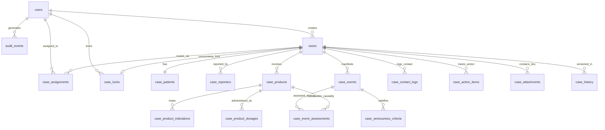

# PharmaSafe — Database Architecture & Relational Schema Design
**System:** PharmaSafe Educational Pharmacovigilance Case Management System  
**Baseline Reference:** Oracle Argus Safety 7.0.3  
**Database Engine:** PostgreSQL 18.4  
**Target Database:** `pharmasafe_db`  
**Migration Tool:** Flyway  
**Regulatory Standards Alignment:** ICH E2B(R3), 21 CFR Part 11 Architecture, GAMP 5 (Educational Implementation)

---

## 1. Executive Summary & Design Principles

PharmaSafe is an educational pharmacovigilance (PV) case management application designed to replicate the workflow, auditability, data integrity, and regulatory rigor of enterprise safety systems like Oracle Argus Safety 7.0.3.

### Core Architecture Principles:
1. **Immutable Audit Trails**: Every clinical case change, user authentication, and workflow transition must be auditable, capturing `who`, `what`, `when`, `originating IP`, and `previous vs. updated values`.
2. **Pessimistic Locking & Concurrency Control**: Cases under review or data entry must support pessimistic locking (`case_locks`) to prevent dual-editor race conditions.
3. **Strict Normalization with Referential Integrity**: Foreign keys enforce referential integrity across patients, reporters, suspect products, and adverse events.
4. **Preservation of Existing Migrations**: Existing Flyway migrations (`V1__init_schema.sql` and `V2__auth_and_audit.sql`) remain completely untouched. All new schema additions will be introduced in subsequent Flyway versioned migrations (`V3`, `V4`, etc.).
5. **No Synthetic / Mock Data in Production Tables**: Empty states must truthfully reflect empty database tables until real cases are processed.

---

## 2. Existing Database Schema (Stages 1 & 2)

The current live database `pharmasafe_db` contains three tables managed via Flyway V1 and V2:

```
+-------------------+      +-------------------+      +-------------------+
|  system_metadata  |      |       users       |      |   audit_events    |
+-------------------+      +-------------------+      +-------------------+
| id (PK)           |      | id (PK, BIGSERIAL)|      | id (PK, BIGSERIAL)|
| property_name (UQ)|      | username (UQ)     |      | event_type        |
| property_value    |      | password_hash     |      | username          |
| description       |      | role              |      | ip_address        |
| created_at        |      | enabled           |      | user_agent        |
| updated_at        |      | failed_login_att. |      | status            |
+-------------------+      | locked            |      | details           |
                           | locked_at         |      | created_at        |
                           | last_login_at     |      +-------------------+
                           | created_at        |
                           | updated_at        |
                           +-------------------+
```

### Table: `system_metadata` (Migration V1)
Stores core system properties and version identifiers.
- `id` (VARCHAR(64), PK)
- `property_name` (VARCHAR(128), UNIQUE, NOT NULL)
- `property_value` (TEXT, NOT NULL)
- `description` (TEXT)
- `created_at`, `updated_at` (TIMESTAMPTZ)

### Table: `users` (Migration V2)
Stores operator and administrator credentials, lockout states, and role definitions.
- `id` (BIGSERIAL, PK)
- `username` (VARCHAR(64), UNIQUE, NOT NULL, indexed)
- `password_hash` (VARCHAR(128), NOT NULL, BCrypt format)
- `role` (VARCHAR(32), NOT NULL, default `ROLE_USER`, indexed)
- `enabled` (BOOLEAN, NOT NULL, default `TRUE`)
- `failed_login_attempts` (INT, NOT NULL, default `0`)
- `locked` (BOOLEAN, NOT NULL, default `FALSE`)
- `locked_at` (TIMESTAMPTZ)
- `last_successful_login_at` (TIMESTAMPTZ)
- `created_at`, `updated_at` (TIMESTAMPTZ)

### Table: `audit_events` (Migration V2)
Stores immutable security and system audit logs.
- `id` (BIGSERIAL, PK)
- `event_type` (VARCHAR(64), NOT NULL, indexed)
- `username` (VARCHAR(64), indexed)
- `ip_address` (VARCHAR(64))
- `user_agent` (VARCHAR(255))
- `status` (VARCHAR(32), NOT NULL)
- `details` (TEXT)
- `created_at` (TIMESTAMPTZ, NOT NULL, indexed)

---

## 3. Complete Planned Relational Schema

Below is the complete entity-relationship model planned for PharmaSafe Stages 4 through 7.

### Entity Relationship Diagram (Overview)



---

### Module 1: Core Safety Cases & Concurrency

#### 1. `cases` (Stage 4)
The primary safety case record aligned with ICH E2B(R3) guidelines.
- `id` (BIGSERIAL, PK)
- `case_number` (VARCHAR(64), NOT NULL, UNIQUE, e.g. `US-2026-0001`): Unique case tracking identifier.
- `country_code` (VARCHAR(3), NOT NULL): ISO 3166-1 alpha-3 (e.g., `USA`, `GBR`, `JPN`).
- `report_type` (VARCHAR(32), NOT NULL): e.g., `Spontaneous`, `Clinical Trial`, `Literature`, `Other`.
- `initial_receipt_date` (DATE, NOT NULL): Date the sponsor first received the report.
- `latest_received_date` (DATE, NOT NULL): Date of latest significant follow-up information.
- `workflow_state` (VARCHAR(32), NOT NULL, default `'Data Entry'`): e.g. `Data Entry`, `Quality Review`, `Medical Review`, `Expedited Reporting`, `Closed`.
- `priority` (VARCHAR(16), NOT NULL, default `'Routine'`): `Routine`, `Priority`, `Expedited (7-day)`, `Expedited (15-day)`.
- `is_serious` (BOOLEAN, NOT NULL, default `FALSE`): Evaluated seriousness determination.
- `is_fatal` (BOOLEAN, NOT NULL, default `FALSE`): Fatal outcome flag.
- `version_number` (INT, NOT NULL, default `1`): Increments upon significant revisions.
- `created_by` (BIGINT, FK -> `users(id)`): User who created the case.
- `created_at` (TIMESTAMPTZ, NOT NULL, default `CURRENT_TIMESTAMP`)
- `updated_at` (TIMESTAMPTZ, NOT NULL, default `CURRENT_TIMESTAMP`)
- **Indexes**:
  - `idx_cases_case_number` (UNIQUE)
  - `idx_cases_country_case` (`country_code`, `case_number`)
  - `idx_cases_workflow_state` (`workflow_state`)
  - `idx_cases_receipt_date` (`latest_received_date`)

#### 2. `case_locks` (Stage 4)
Pessimistic lock registry preventing concurrent edits (matches Argus Safety Case Lock mechanism).
- `case_id` (BIGINT, PK, FK -> `cases(id)` ON DELETE CASCADE)
- `locked_by` (BIGINT, NOT NULL, FK -> `users(id)`): User currently holding the lock.
- `locked_at` (TIMESTAMPTZ, NOT NULL, default `CURRENT_TIMESTAMP`)
- `workstation_ip` (VARCHAR(64))
- `session_id` (VARCHAR(128))

#### 3. `case_history` (Stage 4)
Immutable audit trail of all changes made to case fields.
- `id` (BIGSERIAL, PK)
- `case_id` (BIGINT, NOT NULL, FK -> `cases(id)` ON DELETE CASCADE)
- `field_name` (VARCHAR(64), NOT NULL)
- `old_value` (TEXT)
- `new_value` (TEXT)
- `change_reason` (VARCHAR(255))
- `changed_by` (BIGINT, NOT NULL, FK -> `users(id)`)
- `changed_at` (TIMESTAMPTZ, NOT NULL, default `CURRENT_TIMESTAMP`)
- **Index**: `idx_case_history_case_id` (`case_id`, `changed_at`)

---

### Module 2: Patients & Reporters

#### 4. `case_patients` (Stage 4)
Patient demographics and clinical characteristics (ICH E2B Section B.1).
- `id` (BIGSERIAL, PK)
- `case_id` (BIGINT, NOT NULL, UNIQUE, FK -> `cases(id)` ON DELETE CASCADE)
- `patient_identifier` (VARCHAR(64)): Anonymized initials or patient ID.
- `age_value` (NUMERIC(5,2)): Numeric age value.
- `age_unit` (VARCHAR(16)): `Years`, `Months`, `Weeks`, `Days`, `Decades`.
- `date_of_birth` (DATE)
- `gender` (VARCHAR(16)): `Male`, `Female`, `Unknown`, `Undifferentiated`.
- `weight_kg` (NUMERIC(6,2))
- `height_cm` (NUMERIC(6,2))
- `pregnant` (BOOLEAN)
- `gestation_period_weeks` (NUMERIC(4,1))
- `created_at`, `updated_at` (TIMESTAMPTZ)

#### 5. `case_reporters` (Stage 4)
Primary and secondary healthcare professional / consumer reporters (ICH E2B Section A.2).
- `id` (BIGSERIAL, PK)
- `case_id` (BIGINT, NOT NULL, FK -> `cases(id)` ON DELETE CASCADE)
- `is_primary` (BOOLEAN, NOT NULL, default `FALSE`)
- `qualification` (VARCHAR(32)): `Physician`, `Pharmacist`, `Other Health Professional`, `Lawyer`, `Consumer`.
- `title` (VARCHAR(32))
- `first_name` (VARCHAR(64))
- `last_name` (VARCHAR(64))
- `institution` (VARCHAR(128))
- `department` (VARCHAR(128))
- `city` (VARCHAR(64))
- `state_province` (VARCHAR(64))
- `country_code` (VARCHAR(3), NOT NULL)
- `postal_code` (VARCHAR(20))
- `email` (VARCHAR(128))
- `phone` (VARCHAR(32))
- `created_at`, `updated_at` (TIMESTAMPTZ)
- **Index**: `idx_reporters_case_primary` (`case_id`, `is_primary`)

---

### Module 3: Medicinal Products & Dosages

#### 6. `case_products` (Stage 4)
Suspect, concomitant, interacting, and counteracting drug products (ICH E2B Section B.4).
- `id` (BIGSERIAL, PK)
- `case_id` (BIGINT, NOT NULL, FK -> `cases(id)` ON DELETE CASCADE)
- `product_type` (VARCHAR(16), NOT NULL): `Suspect`, `Concomitant`, `Interacting`, `Treatment`.
- `product_name` (VARCHAR(128), NOT NULL): Trade name or generic name.
- `active_substance` (VARCHAR(128))
- `manufacturer` (VARCHAR(128))
- `batch_lot_number` (VARCHAR(64))
- `formulation` (VARCHAR(64)): e.g., `Tablet`, `Solution for Injection`.
- `route_of_administration` (VARCHAR(64)): e.g., `Oral`, `Intravenous`.
- `start_date` (DATE)
- `stop_date` (DATE)
- `ongoing` (BOOLEAN, default `FALSE`)
- `dechallenge_result` (VARCHAR(32)): `Positive`, `Negative`, `Not Applicable`, `Unknown`.
- `rechallenge_result` (VARCHAR(32)): `Positive`, `Negative`, `Not Done`, `Unknown`.
- `created_at`, `updated_at` (TIMESTAMPTZ)
- **Index**: `idx_case_products_case_id` (`case_id`)

#### 7. `case_product_indications` (Stage 4)
Clinical reason for medication administration.
- `id` (BIGSERIAL, PK)
- `product_id` (BIGINT, NOT NULL, FK -> `case_products(id)` ON DELETE CASCADE)
- `reported_indication` (VARCHAR(255), NOT NULL)
- `meddra_pt_code` (INT): Preferred Term code if MedDRA-coded.
- `meddra_pt_name` (VARCHAR(128))

#### 8. `case_product_dosages` (Stage 4)
Dosage regimens for the product.
- `id` (BIGSERIAL, PK)
- `product_id` (BIGINT, NOT NULL, FK -> `case_products(id)` ON DELETE CASCADE)
- `dose_amount` (NUMERIC(10,3), NOT NULL)
- `dose_unit` (VARCHAR(16), NOT NULL): `mg`, `g`, `ml`, `mcg`, `IU`.
- `frequency` (VARCHAR(32)): `Once daily`, `BID`, `TID`, `PRN`, `Continuous`.

---

### Module 4: Adverse Events & Seriousness Assessment

#### 9. `case_events` (Stage 4)
Signs, symptoms, and diagnoses reported as adverse events (ICH E2B Section B.2).
- `id` (BIGSERIAL, PK)
- `case_id` (BIGINT, NOT NULL, FK -> `cases(id)` ON DELETE CASCADE)
- `event_verbatim` (VARCHAR(255), NOT NULL): Event as verbatim reported by the reporter.
- `meddra_llt_code` (INT): Lowest Level Term code.
- `meddra_llt_name` (VARCHAR(128))
- `meddra_pt_code` (INT): Preferred Term code.
- `meddra_pt_name` (VARCHAR(128))
- `meddra_soc_name` (VARCHAR(128)): System Organ Class.
- `onset_date` (DATE, NOT NULL)
- `stop_date` (DATE)
- `outcome` (VARCHAR(32), NOT NULL): `Recovered/Resolved`, `Recovering/Resolving`, `Not Recovered`, `Fatal`, `Recovered with Sequelae`, `Unknown`.
- `is_serious` (BOOLEAN, NOT NULL, default `FALSE`)
- `created_at`, `updated_at` (TIMESTAMPTZ)
- **Index**: `idx_case_events_case_id` (`case_id`)

#### 10. `case_seriousness_criteria` (Stage 4)
Standard ICH E2B seriousness criteria satisfied by the event.
- `id` (BIGSERIAL, PK)
- `event_id` (BIGINT, NOT NULL, FK -> `case_events(id)` ON DELETE CASCADE)
- `results_in_death` (BOOLEAN, default `FALSE`)
- `life_threatening` (BOOLEAN, default `FALSE`)
- `requires_hospitalization` (BOOLEAN, default `FALSE`)
- `disabling_incapacitating` (BOOLEAN, default `FALSE`)
- `congenital_anomaly` (BOOLEAN, default `FALSE`)
- `other_medically_important` (BOOLEAN, default `FALSE`)

#### 11. `case_event_assessments` (Stage 4)
Causality evaluation linking a specific suspect product with a specific adverse event.
- `id` (BIGSERIAL, PK)
- `case_id` (BIGINT, NOT NULL, FK -> `cases(id)` ON DELETE CASCADE)
- `product_id` (BIGINT, NOT NULL, FK -> `case_products(id)` ON DELETE CASCADE)
- `event_id` (BIGINT, NOT NULL, FK -> `case_events(id)` ON DELETE CASCADE)
- `causality_reporter` (VARCHAR(32)): `Related`, `Not Related`, `Unassessable`.
- `causality_company` (VARCHAR(32)): `Reasonable Possibility`, `No Reasonable Possibility`.
- `expectedness` (VARCHAR(16)): `Expected` (Listed), `Unexpected` (Unlisted).
- `assessed_by` (BIGINT, FK -> `users(id)`)
- `assessed_at` (TIMESTAMPTZ, default `CURRENT_TIMESTAMP`)
- **Constraint**: UNIQUE (`product_id`, `event_id`)

---

### Module 5: Workflow, Assignments & Worklist

#### 12. `case_assignments` (Stage 5)
Tracks case assignment to safety specialists, medical reviewers, or queues (Argus Home Page Section B: *Cases Assigned*).
- `id` (BIGSERIAL, PK)
- `case_id` (BIGINT, NOT NULL, FK -> `cases(id)` ON DELETE CASCADE)
- `assigned_to_user_id` (BIGINT, NOT NULL, FK -> `users(id)`)
- `assigned_by_user_id` (BIGINT, NOT NULL, FK -> `users(id)`)
- `workflow_state` (VARCHAR(32), NOT NULL): `Data Entry`, `Quality Review`, `Medical Review`, `Expedited Reporting`.
- `status` (VARCHAR(16), NOT NULL, default `'Pending'`): `Pending`, `In Progress`, `Completed`, `Reassigned`.
- `assigned_at` (TIMESTAMPTZ, NOT NULL, default `CURRENT_TIMESTAMP`)
- `due_date` (DATE)
- `completed_at` (TIMESTAMPTZ)
- **Indexes**:
  - `idx_case_assignments_user_status` (`assigned_to_user_id`, `status`)
  - `idx_case_assignments_case_id` (`case_id`)

#### 13. `case_routing_history` (Stage 5)
Records routing forward / return actions across workflow queues (Argus Quick Launch *Forward Case* / *Return Case*).
- `id` (BIGSERIAL, PK)
- `case_id` (BIGINT, NOT NULL, FK -> `cases(id)` ON DELETE CASCADE)
- `from_state` (VARCHAR(32), NOT NULL)
- `to_state` (VARCHAR(32), NOT NULL)
- `routed_by` (BIGINT, NOT NULL, FK -> `users(id)`)
- `routing_comment` (TEXT)
- `routed_at` (TIMESTAMPTZ, NOT NULL, default `CURRENT_TIMESTAMP`)

---

### Module 6: Contact Log & Action Items

#### 14. `case_contact_logs` (Stage 5)
Communications with reporters, affiliates, or investigative sites (Argus Home Page Section C: *Contact Log Entries*).
- `id` (BIGSERIAL, PK)
- `case_id` (BIGINT, NOT NULL, FK -> `cases(id)` ON DELETE CASCADE)
- `contact_date` (DATE, NOT NULL): Date of communication.
- `contact_type` (VARCHAR(32), NOT NULL): `Phone`, `Email`, `Letter`, `Fax`, `Meeting`.
- `contact_person` (VARCHAR(128))
- `description` (TEXT, NOT NULL): Description of communication.
- `created_by` (BIGINT, NOT NULL, FK -> `users(id)`)
- `created_at` (TIMESTAMPTZ, NOT NULL, default `CURRENT_TIMESTAMP`)
- **Index**: `idx_contact_logs_case` (`case_id`, `contact_date`)

#### 15. `case_action_items` (Stage 5)
Pending tasks, queries, and follow-up deadlines (Argus Home Page Section D: *Action Item Entries*).
- `id` (BIGSERIAL, PK)
- `case_id` (BIGINT, NOT NULL, FK -> `cases(id)` ON DELETE CASCADE)
- `action_type` (VARCHAR(64), NOT NULL): `Targeted Follow-up Questionnaire`, `Autopsy Report Request`, `Batch Sample Return`.
- `assigned_to` (BIGINT, NOT NULL, FK -> `users(id)`)
- `due_on` (DATE, NOT NULL): Due date for action item.
- `status` (VARCHAR(16), NOT NULL, default `'Open'`): `Open`, `In Progress`, `Completed`, `Cancelled`.
- `description` (TEXT, NOT NULL): Detailed action description.
- `completed_at` (TIMESTAMPTZ)
- `created_at` (TIMESTAMPTZ, NOT NULL, default `CURRENT_TIMESTAMP`)
- **Index**: `idx_action_items_assigned_due` (`assigned_to`, `status`, `due_on`)

---

### Module 7: Attachments, Literature & Duplicates

#### 16. `case_attachments` (Stage 6)
Source documents, hospital records, lab reports, and CIOMS forms.
- `id` (BIGSERIAL, PK)
- `case_id` (BIGINT, NOT NULL, FK -> `cases(id)` ON DELETE CASCADE)
- `file_name` (VARCHAR(255), NOT NULL)
- `file_type` (VARCHAR(64), NOT NULL): MIME type (e.g., `application/pdf`).
- `file_size_bytes` (BIGINT, NOT NULL)
- `storage_path` (VARCHAR(512), NOT NULL)
- `checksum_sha256` (VARCHAR(64), NOT NULL): Cryptographic hash verifying document integrity.
- `classification` (VARCHAR(64)): `Source Document`, `Medical Record`, `Discharge Summary`, `Autopsy Report`.
- `uploaded_by` (BIGINT, NOT NULL, FK -> `users(id)`)
- `uploaded_at` (TIMESTAMPTZ, NOT NULL, default `CURRENT_TIMESTAMP`)

#### 17. `case_literature_references` (Stage 6)
Scientific publication citations for literature reports.
- `id` (BIGSERIAL, PK)
- `case_id` (BIGINT, NOT NULL, FK -> `cases(id)` ON DELETE CASCADE)
- `journal_title` (VARCHAR(255), NOT NULL)
- `year` (INT)
- `volume` (VARCHAR(32))
- `page_numbers` (VARCHAR(32))
- `doi` (VARCHAR(128))
- `pmid` (VARCHAR(32))

#### 18. `case_duplicate_reviews` (Stage 6)
Tracks potential duplicate evaluation and merge history.
- `id` (BIGSERIAL, PK)
- `master_case_id` (BIGINT, NOT NULL, FK -> `cases(id)`)
- `duplicate_case_id` (BIGINT, NOT NULL, FK -> `cases(id)`)
- `similarity_score` (NUMERIC(5,2))
- `review_decision` (VARCHAR(32), NOT NULL): `Confirmed Duplicate - Merged`, `Distinct Cases`, `Pending Review`.
- `reviewed_by` (BIGINT, NOT NULL, FK -> `users(id)`)
- `reviewed_at` (TIMESTAMPTZ, NOT NULL, default `CURRENT_TIMESTAMP`)
- `review_comments` (TEXT)

---

## 4. Development Stage Roadmap

| Stage | Focus Area | Database Schema Scope | Status |
|:---|:---|:---|:---|
| **Stage 1** | Base System & DB Provisioning | `system_metadata` | Completed |
| **Stage 2** | Authentication, Lockout & Audit Trail | `users`, `audit_events` | Completed |
| **Stage 3** | Enterprise Dashboard & Layout Architecture | UI & Relational Architecture Document | Completed |
| **Stage 4** | Safety Case Management Schema & Entry | `cases`, `case_patients`, `case_reporters`, `case_products`, `case_events`, `case_assessments`, `case_medical_history`, `case_references`, `case_attachments`, `case_number_seq` | **Completed (Migration V3)** |
| **Stage 5** | Workflow Routing, Worklist, Contact Log & Action Items | `case_assignments`, `case_routing_history`, `case_contact_logs`, `case_action_items` | Planned |
| **Stage 6** | Regulatory Expedited Reporting & E2B(R3) | `case_literature_references`, `case_duplicate_reviews`, `expedited_reports` | Planned |
| **Stage 7** | Standard Dictionaries & Enterprise Integrations | MedDRA browser tables, WHO Drug dictionary, analytics | Planned |

---

## 4.1. Stage 4 Implemented Schema Details (Migration V3)

Migration file: `V3__case_management.sql`

### 1. `case_number_seq` (Sequence)
- Atomic sequence starting at 1001 for generating unique, non-colliding case numbers formatted as `PS-YYYY-COUNTRY-#####` (e.g., `PS-2026-USA-01001`).

### 2. `cases` (Primary Safety Case)
- **Primary Key:** `id BIGSERIAL`
- **Unique Identifier:** `case_number VARCHAR(64) UNIQUE NOT NULL`
- **Foreign Keys:**
  - `created_by_user_id` -> `users(id) ON DELETE SET NULL`
  - `updated_by_user_id` -> `users(id) ON DELETE SET NULL`
  - `assigned_to_user_id` -> `users(id) ON DELETE SET NULL`
- **Key Columns:** `country_code`, `report_type`, `initial_receipt_date`, `latest_received_date`, `workflow_state`, `priority`, `is_serious`, `is_fatal`, `narrative`, `company_comments`, `version_number`, `created_at`, `updated_at`.
- **Check Constraints:**
  - `chk_cases_dates`: `CHECK (latest_received_date >= initial_receipt_date)`
  - `chk_cases_priority`: `CHECK (priority IN ('Routine', 'Priority', 'Expedited'))`
  - `chk_cases_workflow_state`: `CHECK (workflow_state IN ('Draft', 'Data Entry', 'Quality Review', 'Medical Review', 'Closed'))`

### 3. `case_patients` (Demographics & Characteristics)
- **Primary Key:** `id BIGSERIAL`
- **Foreign Key:** `case_id BIGINT UNIQUE NOT NULL` -> `cases(id) ON DELETE CASCADE`
- **Columns:** `patient_identifier`, `age_value`, `age_unit`, `date_of_birth`, `gender`, `weight_kg`, `height_cm`, `pregnant`, `medical_history`.
- **PII Minimization:** Only patient initials/identifier stored; full names and government IDs excluded by design.

### 4. `case_reporters` (Primary & Secondary Reporters)
- **Primary Key:** `id BIGSERIAL`
- **Foreign Key:** `case_id BIGINT NOT NULL` -> `cases(id) ON DELETE CASCADE`
- **Columns:** `is_primary`, `qualification`, `title`, `first_name`, `last_name`, `institution`, `department`, `city`, `state_province`, `country_code`, `postal_code`, `email`, `phone`.
- **Check Constraint:** `chk_reporter_qualification`: `CHECK (qualification IN ('Physician', 'Pharmacist', 'Other Health Professional', 'Lawyer', 'Consumer'))`

### 5. `case_products` (Suspect & Concomitant Drugs)
- **Primary Key:** `id BIGSERIAL`
- **Foreign Key:** `case_id BIGINT NOT NULL` -> `cases(id) ON DELETE CASCADE`
- **Columns:** `product_type`, `product_name`, `active_substance`, `indication`, `dosage_text`, `dosage_amount`, `dosage_unit`, `frequency`, `formulation`, `route_of_administration`, `batch_lot_number`, `start_date`, `stop_date`, `ongoing`, `dechallenge_result`, `rechallenge_result`.
- **Check Constraints:**
  - `chk_product_type`: `CHECK (product_type IN ('Suspect', 'Concomitant', 'Interacting', 'Treatment'))`
  - `chk_product_dates`: `CHECK (stop_date IS NULL OR start_date IS NULL OR stop_date >= start_date)`

### 6. `case_events` (Adverse Events & Seriousness Assessment)
- **Primary Key:** `id BIGSERIAL`
- **Foreign Key:** `case_id BIGINT NOT NULL` -> `cases(id) ON DELETE CASCADE`
- **Columns:** `event_verbatim`, `meddra_pt`, `meddra_llt`, `meddra_soc`, `onset_date`, `stop_date`, `outcome`, `is_serious`, `results_in_death`, `life_threatening`, `requires_hospitalization`, `disabling_incapacitating`, `congenital_anomaly`, `other_medically_important`.
- **Check Constraints:**
  - `chk_event_outcome`: `CHECK (outcome IN ('Recovered/Resolved', 'Recovering/Resolving', 'Not Recovered', 'Fatal', 'Recovered with Sequelae', 'Unknown'))`
  - `chk_event_dates`: `CHECK (stop_date IS NULL OR stop_date >= onset_date)`

### 7. `case_assessments` (Causality & Expectedness)
- **Primary Key:** `id BIGSERIAL`
- **Foreign Key:** `case_id BIGINT NOT NULL` -> `cases(id) ON DELETE CASCADE`
- **Columns:** `product_name`, `event_verbatim`, `causality_reporter`, `causality_company`, `expectedness`, `assessment_comment`, `assessed_by`, `assessed_at`.

### 8. `case_medical_history` (Past Medical History)
- **Primary Key:** `id BIGSERIAL`
- **Foreign Key:** `case_id BIGINT NOT NULL` -> `cases(id) ON DELETE CASCADE`
- **Columns:** `condition_name`, `start_date`, `end_date`, `continuing`, `notes`.

### 9. `case_references` (Literature & External Identifiers)
- **Primary Key:** `id BIGSERIAL`
- **Foreign Key:** `case_id BIGINT NOT NULL` -> `cases(id) ON DELETE CASCADE`
- **Columns:** `reference_type`, `reference_id`, `description`.

### 10. `case_attachments` (Document Metadata)
- **Primary Key:** `id BIGSERIAL`
- **Foreign Key:** `case_id BIGINT NOT NULL` -> `cases(id) ON DELETE CASCADE`
- **Columns:** `file_name`, `file_type`, `file_size_bytes`, `storage_path`, `checksum_sha256`, `classification`, `uploaded_by_user_id`, `uploaded_at`.

---

## 5. Security, Auditability & Regulatory Alignment

1. **21 CFR Part 11 Audit Trail**:
   - Updates to any column in `cases`, `case_patients`, `case_products`, and `case_events` must automatically generate a record in `case_history`.
   - Records are strictly append-only (no `DELETE` or `UPDATE` allowed on `case_history` or `audit_events`).
2. **Data Integrity & Referential Constraints**:
   - `ON DELETE CASCADE` is restricted strictly to dependent sub-records of an active draft case.
   - Closed or submitted cases cannot be dropped or purged.
3. **Role-Based Access Control (RBAC)**:
   - `ROLE_ADMIN`: User management, security audit logs inspection, system configuration.
   - `ROLE_USER`: Case data entry, workflow routing, medical review, contact log entry.
4. **Password & Credential Security**:
   - Plaintext passwords and hashes are never exposed in audit logs, API responses, or front-end memory.
